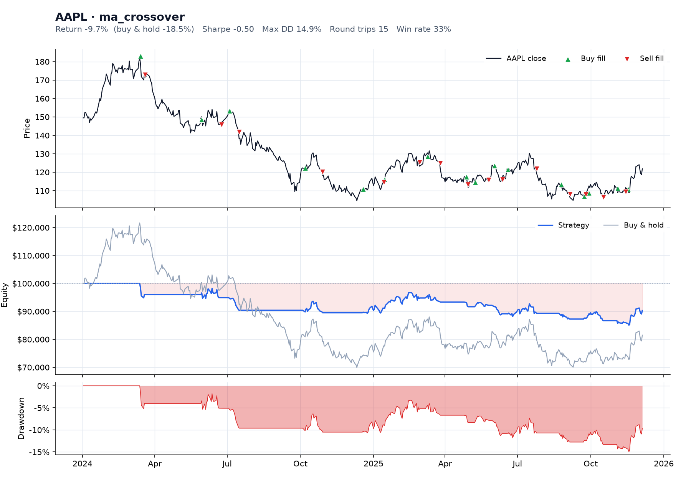
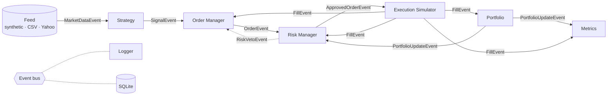
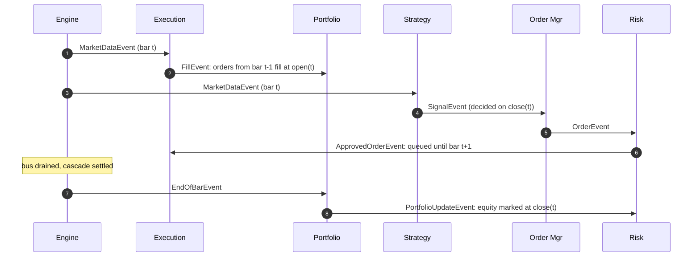

# Event-Driven Trading System

[](https://github.com/Space-Paragon1/Event-Driven-Trading-System/actions/workflows/ci.yml)


[](https://github.com/astral-sh/ruff)
[](LICENSE)

A causal, event-driven backtesting engine in Python. Market data, signals, orders, risk
checks, fills and portfolio snapshots are typed, immutable events on a publish/subscribe
bus. No component calls another directly, so any of them can be swapped, tested in
isolation, or recorded.

The goal is a backtest you can trust: **no look-ahead**, **correct long/short accounting**,
**mark-to-market metrics on every bar**, and **deterministic, reproducible runs**, each
property enforced by tests.



<sub>Two years of synthetic daily bars, 5/20 SMA crossover, long-only. Reproduce it with
`make demo`.</sub>

## Highlights

- **No look-ahead bias.** Strategies see bar *t* after it closes; orders fill at bar
  *t + 1*'s open, with adverse slippage and commission.
- **Strictly causal event loop.** Each bar's full event cascade settles before the next bar
  is read.
- **Target-position order management.** Signals express a desired exposure, and the order
  manager trades only the difference against filled *plus working* orders, so repeated
  signals never pile up.
- **Pre-trade risk.** A position limit and a drawdown circuit breaker that always lets you
  reduce risk.
- **Correct accounting.** Average-cost P&L for longs, shorts and flips, checked by
  property-based tests.
- **Rich analytics.** CAGR, volatility, Sharpe, Sortino, Calmar, max drawdown depth and
  duration, round-trip win rate, profit factor, exposure, and a buy-and-hold benchmark.
- **Pluggable data.** Synthetic GBM (seeded), CSV replay, or Yahoo Finance.
- **Run store.** Every event of every run goes to SQLite, tagged with a run ID, alongside the
  config and final report.
- **Engineering.** Strict mypy, ruff, 220+ tests at 97% branch coverage, CI on Linux, macOS
  and Windows across Python 3.11–3.14.

## Quick start

```bash
git clone https://github.com/Space-Paragon1/Event-Driven-Trading-System.git
cd Event-Driven-Trading-System
python -m venv .venv && source .venv/bin/activate   # Windows: .venv\Scripts\activate
pip install -e ".[all]"                              # core needs only PyYAML

trading-backtest                                     # synthetic data, MA crossover
```

```bash
trading-backtest --strategy rsi --bars 1000                      # another strategy, longer run
trading-backtest --symbol SPY --from 2020-01-01 --to 2025-01-01  # real data (Yahoo Finance)
trading-backtest --csv prices.csv --symbol SPY                   # your own data
trading-backtest --allow-short --quantity 200                    # long/short, bigger size
trading-backtest --save-chart run.png                            # chart to file (--chart: window)
trading-backtest --json | jq .metrics.sharpe_ratio               # machine-readable output
trading-backtest --config my.yaml -v                             # full config, log every event
```

`python -m trading` works too, as does `python main.py` from a checkout without installing the package. Run
`trading-backtest --help` for every option.

<details>
<summary>Sample output</summary>

```text
16:10:07  [Signal]     AAPL 2024-03-13 00:00  BUY strength=0.0076
16:10:07  [Order]      AAPL 2024-03-13 00:00  O000001 BUY 400 @ ref 181.90
16:10:07  [Approved]   AAPL 2024-03-13 00:00  O000001
16:10:07  [Fill]       AAPL 2024-03-14 00:00  O000001 BUY 400 @ 182.9983  comm=4.00
...

Backtest  AAPL | ma_crossover | synthetic data | 504 bars (2024-01-02 to 2025-12-05)

==============================================
  PERFORMANCE REPORT
==============================================
  Final equity                      $90,330.60
  Total return                         -9.67 %
  Buy & hold                          -18.49 %
  CAGR                                 -4.96 %
  Volatility (ann.)                     9.25 %
  Sharpe ratio                          -0.503
  Sortino ratio                         -0.700
  Max drawdown             14.89 %  (452 bars)
  Calmar ratio                          -0.333
----------------------------------------------
  Round trips                               15
  Win rate                              33.3 %
  Profit factor                          0.311
  Avg trade P&L                       $-936.86
  Fills                                     31
  Commission                           $124.00
  Exposure                              40.1 %
==============================================
```

The order is placed on the signal bar's close (03-13) and filled at the next bar's open
(03-14). Logs go to stderr and results to stdout.
</details>

## How it works

### Components



Every arrow is an event on the bus. The logger and SQLite writer subscribe to everything.

| Event | Published by | Meaning |
|---|---|---|
| `MarketDataEvent` | engine (from a feed) | one OHLCV bar |
| `SignalEvent` | strategy | BUY / SELL / HOLD plus strength in [0, 1] |
| `OrderEvent` | order manager | market order sized to reach the target position |
| `ApprovedOrderEvent` | risk manager | order passed every check |
| `RiskVetoEvent` | risk manager | order rejected, with reason |
| `FillEvent` | execution simulator | execution at the next bar's open |
| `PortfolioUpdateEvent` | portfolio | mark-to-market snapshot, once per bar |
| `EndOfBarEvent` | engine | clock tick: the bar's cascade has settled |

Events are frozen, slotted, keyword-only dataclasses.

### One bar, step by step



The engine is the clock:

```python
for bar in feed:
    bus.publish(bar)
    bus.run()  # fills, signal, order, risk decision
    bus.publish(EndOfBarEvent(...))
    bus.run()  # mark-to-market snapshot
```

### Design decisions

| Decision | Why |
|---|---|
| **Drain the bus after every bar** | Queuing all bars first (a common mistake) makes every signal run *after* the whole dataset is processed, so every order is priced off the final bar. A regression test pins this. |
| **Fill at the next open** | A decision made on bar *t*'s close cannot trade at that close. Slippage is adverse, never symmetric noise that averages to zero. |
| **Target positions, not order sizes** | BUY means "be long *N*". The order manager orders the delta against the filled position plus working orders, so a strategy can emit BUY every bar without stacking exposure. |
| **Risk checks only constrain new exposure** | Reducing or closing a position is always allowed, even with the drawdown breaker tripped. Getting out must never be blocked. |
| **Explicit end-of-bar clock event** | The portfolio snapshot has to include fills that happened *during* the bar, which only the engine can know have settled. |
| **Sequential IDs and seeded randomness** | Two runs with the same config produce identical events, fills and reports. |
| **Fail fast** | Handler exceptions propagate, and invalid config, unknown keys and malformed data raise precise errors. A strategy name that doesn't exist won't silently become `random`. |

## Strategies

| Key | Logic |
|---|---|
| `ma_crossover` | BUY when SMA(fast) crosses above SMA(slow), SELL on the cross below |
| `rsi` | Wilder's RSI: BUY on crossing into oversold, SELL on crossing into overbought (mean reversion) |
| `random` | Uniform random BUY/SELL/HOLD: a null baseline any real strategy should beat |

With `allow_short: false` (the default), SELL exits to flat. With `true`, it reverses to a
short of the same size.

### Writing your own

Subclass `Strategy` and implement `on_bar`. Wiring and publishing are handled for you:

```python
from trading import BacktestConfig, BacktestEngine, Signal, Strategy
from trading.events.types import Direction, MarketDataEvent
from trading.signal.indicators import SMA


class TrendFilter(Strategy):
    """Long while the close is above its 50-bar average, flat otherwise."""

    name = "trend_filter"

    def __init__(self, period: int = 50) -> None:
        super().__init__()
        self.sma = SMA(period)

    def on_bar(self, bar: MarketDataEvent) -> Signal:
        avg = self.sma.update(bar.close)
        if avg is None:
            return Direction.HOLD, 0.0
        return (Direction.BUY if bar.close > avg else Direction.SELL), 1.0


result = BacktestEngine(BacktestConfig(), strategy=TrendFilter()).run()
print(result.report)
```

This emits BUY on *every* bar above the average, yet trades only when the regime flips. That
comes from target-position sizing. To make it available from the CLI and config, add it to
`STRATEGIES` in [`signal/registry.py`](src/trading/signal/registry.py).

## Configuration

Settings come from built-in defaults, then an optional YAML file (`--config`), then CLI
flags. [`config/default.yaml`](config/default.yaml) lists every key with its default and
comments.

```yaml
simulation:  { symbol: AAPL, data_source: synthetic, n_bars: 252, seed: 42 }
strategy:    { type: ma_crossover, fast_period: 5, slow_period: 20 }
order_manager: { quantity: 100, allow_short: false }
execution:   { slippage_bps: 1.0, commission_per_share: 0.01 }
risk:        { max_position: 500, max_drawdown_pct: 10.0 }
portfolio:   { starting_cash: 100000.0 }
metrics:     { periods_per_year: null, risk_free_rate: 0.0 }  # null = infer from interval
persistence: { enabled: true, db_path: trading.db }
```

The config is validated: unknown keys, wrong types and inconsistent values are rejected
with their location and a suggestion:

```text
$ trading-backtest --config bad.yaml
trading-backtest: error: strategy.type: unknown strategy 'rsii' (did you mean 'rsi'?) ...
```

## Metrics

Metrics are computed on the per-bar equity curve, annualised with `periods_per_year`
(inferred: 252 for daily bars, 52 for weekly, and so on).

| Metric | Definition |
|---|---|
| Total return / CAGR | Final over starting equity; CAGR compounds over `bars / periods_per_year` years |
| Volatility | Sample std. dev. of per-bar returns × √periods_per_year |
| Sharpe / Sortino | Mean excess return over std. dev. (Sortino: downside deviation only), annualised |
| Max drawdown | Deepest peak-to-trough fall, and the longest stretch spent below a prior peak |
| Calmar | CAGR / max drawdown |
| Round trips / win rate | Trades from flat to flat (flips split into two), net of commission |
| Profit factor | Gross profit / gross loss over round trips |
| Exposure | Share of bars holding a position |
| Buy & hold | First-to-last close of the instrument, as a benchmark |

## Persistence

Each run writes to SQLite (`--db PATH`, `--no-db` to disable). The `runs` table holds the
config and final report as JSON. Every other table holds one event type, keyed by `run_id`.
A run is a single transaction, so a crash leaves nothing behind.

```sql
-- Compare runs
SELECT run_id, strategy, json_extract(report_json, '$.sharpe_ratio') AS sharpe
FROM runs ORDER BY started_at DESC;

-- Fills of the latest run
SELECT timestamp, direction, quantity, fill_price FROM fills
WHERE run_id = (SELECT run_id FROM runs ORDER BY started_at DESC LIMIT 1);
```

## Development

```bash
make install     # pip install -e ".[dev]" and pre-commit hooks
make check       # ruff + strict mypy + tests with coverage (what CI runs)
make demo        # regenerate docs/images/backtest.png
```

Without `make`: `ruff check . && ruff format --check . && mypy && pytest --cov`.

The tests aim at the properties a backtest must not violate, not just per-unit behaviour:

- **Causality.** No fill is earlier than its order, orders fill at the next bar's open, and
  the strategy never sees future bars.
- **Accounting invariants.** On every bar of every strategy (long-only and long/short),
  `equity == cash + position × close`. Cash reconciles exactly with the fill history.
- **Property-based tests** ([Hypothesis](https://hypothesis.readthedocs.io)). For random
  fill sequences, realized + unrealized P&L equals the cash-flow P&L.
- **Reference values.** RSI matches Wilder's published worked example.
- **Regression tests** for each bug fixed in 0.2.0 (see the [changelog](CHANGELOG.md)).

### Layout

```text
src/trading/
├── backtest/engine.py         # wiring and the bar-by-bar event loop
├── bus/event_bus.py           # FIFO, breadth-first pub/sub
├── events/types.py            # every event type
├── market_data/               # Feed protocol, synthetic GBM, CSV, Yahoo Finance
├── signal/                    # Strategy base, indicators, MA crossover, RSI, random, registry
├── order_manager/manager.py   # target-position order sizing
├── risk/manager.py            # position limit and drawdown breaker
├── execution/simulator.py     # next-open fills, slippage, commission
├── portfolio/                 # Position accounting, PositionBook, PortfolioTracker
├── metrics/                   # pure stats, round-trip trades, report
├── persistence/sqlite_writer.py
├── visualization/chart.py
├── logger/handler.py
├── config.py                  # typed, validated configuration
└── cli.py                     # trading-backtest
```

## Limitations

These are deliberate scope limits, not oversights:

- One symbol per run (components are keyed by symbol, but the engine feeds a single stream).
- Market orders only, filled in full at the next open. No limit orders, partial fills or
  volume/liquidity constraints.
- No margin, borrow costs or interest on cash.
- The synthetic calendar skips weekends but not market holidays.
- Yahoo Finance data is split/dividend-adjusted (`auto_adjust=True`) and unofficial. Use CSV
  for data you control.

## License

MIT. See [LICENSE](LICENSE).
